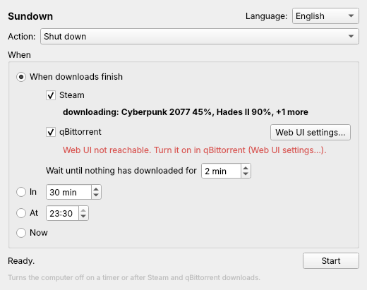

# Sundown

**Turn the computer off when your Steam and qBittorrent downloads finish, or on a timer.**
For KDE Plasma 6 and other systemd desktops. No terminal, no sudo.



## Install

1. Download **Sundown-x86_64.AppImage** from the [Releases](../../releases/latest) page.
2. Double-click it. If Plasma asks whether to make it executable, say yes.
   (Or: right-click → Properties → Permissions → *Is executable*.)
3. Pick what to do and when, then press **Start**.

After the first launch Sundown also appears in your application menu. Keep the AppImage
somewhere permanent (for example `~/Applications`); if you move it, start it once from
the new place and the menu entry follows.

## Features

- **Action:** shut down, restart or sleep.
- **When downloads finish:** watches Steam and qBittorrent and shows what is downloading
  right now (with progress for torrents). When nothing has downloaded for a few minutes (2 by default, so Steam can
  move on to the next game in its queue), it acts.
- **In N minutes**, **at a time** (e.g. 23:30), or **now**.
- A **60-second countdown with Cancel** always comes first, so nothing turns off by surprise.
- While it waits, the computer is kept from going to sleep on its own.
- Close the window and Sundown keeps waiting in the system tray.
- English, Ukrainian and Russian interface.

## qBittorrent setup (once)

Sundown reads qBittorrent through its Web UI:

1. In qBittorrent: **Tools → Options → Web UI**, tick **Web User Interface (Remote control)**.
2. Tick **Bypass authentication for clients on localhost**. Then Sundown needs no password.
   (Or type the Web UI username and password in Sundown → *Web UI settings…*.)
3. Press *Test* in Sundown's *Web UI settings…* to check.

If something is wrong, Sundown says what and how to fix it: the Web UI is off, its port
is taken by another program (Steam often sits on 8080, the default; then use 8090), the
port is below 1024, or qBittorrent has not applied the setting yet (quit it from the tray
and start it again). Sundown follows the port set in qBittorrent by itself.

Paused torrents never count. Torrents with no peers (*stalled*) do not count either,
because a dead torrent would keep the computer on forever; tick *Also wait for stalled
torrents* if you want them to.

## How it works

- **Steam:** reads the `appmanifest_*.acf` files in every Steam library
  (`libraryfolders.vdf`, native and Flatpak Steam). An app whose state says update
  running / downloading / staging / validating counts as downloading; queued updates that
  are not running and paused downloads do not. Steam updates the byte counters in these
  files only now and then, so Sundown shows no percentage for Steam.
- **qBittorrent:** asks the Web UI API (`/api/v2/torrents/info`) for torrents in the
  downloading, queued, metadata, checking and moving states.
- If a watched source cannot be read (for example the qBittorrent Web UI is off while
  qBittorrent runs), Sundown keeps waiting and shows the error, rather than turning the
  computer off too early. A program that is not running counts as finished.
- **Power:** `systemctl poweroff | reboot | suspend` through systemd-logind, which allows
  the user of the active local session to do this without sudo.
- **Staying awake:** `org.freedesktop.PowerManagement.Inhibit` on the session bus
  (Plasma's power management), released before the action runs.

The qBittorrent password, if you use one, is stored in plain text in
`~/.config/sundown/sundown.conf`. Using the localhost bypass avoids storing it.

## Uninstall

Delete the AppImage, `~/.local/share/applications/sundown.desktop` and
`~/.config/sundown/`.

## Build from source

```bash
pip install PySide6-Essentials pyinstaller
python3 sundown.py                    # run
python3 -m unittest discover tests    # tests
bash packaging/build-appimage.sh      # build dist/Sundown-x86_64.AppImage (needs appimagetool)
```

`SUNDOWN_DRY_RUN=1 python3 sundown.py` prints the action instead of running it.

Pushing a `v*` tag (or running the "Build AppImage" workflow with a version) builds the
AppImage with GitHub Actions and attaches it to the release.

---

## Українською

**Sundown** вимикає комп'ютер, коли завершаться завантаження у Steam і qBittorrent, або за
таймером (через N хвилин, о певній годині, зараз). Також уміє перезавантажити чи
приспати. Перед дією завжди 60 секунд відліку з кнопкою «Скасувати».

**Встановлення:** скачайте `Sundown-x86_64.AppImage` зі сторінки
[Releases](../../releases/latest), двічі клацніть по ньому, оберіть дію і коли, натисніть
**Запустити**. Мову можна змінити у правому верхньому куті.

**qBittorrent:** у qBittorrent увімкніть Інструменти → Налаштування → Веб-інтерфейс і
позначте «Пропускати автентифікацію для клієнтів на localhost».

---

## License

Sundown © 2026 Bayashem, MIT. Built with [Claude Code](https://claude.com/claude-code).
See [LICENSE](LICENSE).
